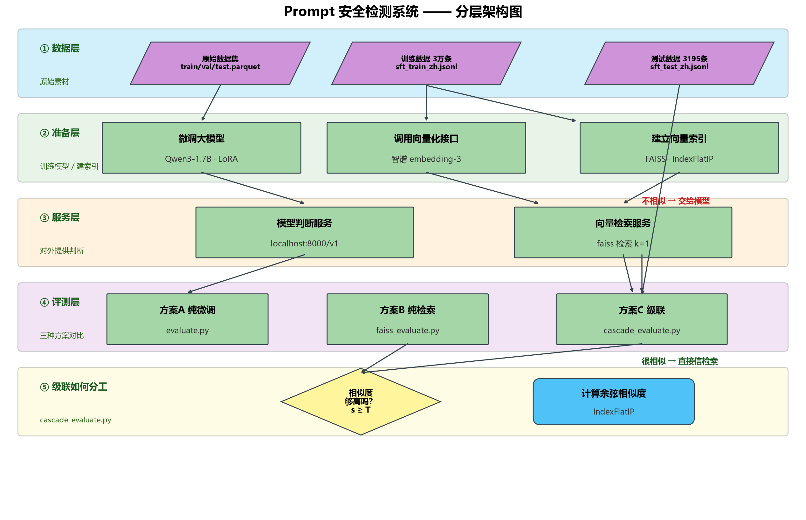

# Prompt 安全检测系统 · LoRA 微调与检索级联

对输入 Prompt 做 safe / unsafe 二分类的安全检测系统。设计"**检索做一线、模型做兜底**"的置信度级联路由架构，独立完成数据构建、模型训练、推理部署与量化评测全流程。



## 三条技术路线评测结果

| 方案 | 准确率 | 平均延迟 | 特点 |
|---|---|---|---|
| LoRA 微调 Qwen3-1.7B | **85.98%** | 2.24s/条 | 精度最高，泛化能力由模型提供 |
| FAISS 向量检索（智谱 embedding-3） | 75.71% | **0.23s/条** | 快 10 倍、零训练成本，受限于近邻覆盖 |
| **置信度级联路由（本系统）** | **85.41%** | 2.12s/条 | 精度近无损，速度与成本可调 |

级联路由规则：检索相似度 ≥ 0.8 直接采用检索结果，否则交由微调模型精判。阈值是可调旋钮——安全场景选择保守阈值（准确率优先），对延迟敏感的场景可调低阈值让更多流量走检索。

## 数据管线

从 26 万条多源原始语料构建中文 Prompt 安全二分类数据集：

```
多源原始语料 26 万条
  → 中文语言过滤（保留中文为主的样本）
  → 短文本清洗（过滤过短无效样本）
  → 分层采样（safe / unsafe 严格 1:1，各 1.5 万条）
  → 训练集 3 万条（类别平衡，防模型偏向多数类刷准确率）
  → 测试集 3195 条（保留自然分布，训练防偏、评估真实）
```

固定随机种子，全流程可复现。

## LoRA 训练配置

| 参数 | 值 | 说明 |
|---|---|---|
| 底座模型 | Qwen3-1.7B | 二分类任务不需要大模型世界知识 |
| 框架 | LLaMA-Factory | |
| rank / alpha / dropout | 8 / 16 / 0 | 低秩增量，只训极小参数量 |
| 目标模块 | q/k/v/o_proj + gate/up/down_proj | 注意力 + FFN 共 7 模块全覆盖 |
| 学习率 | 5e-5 | AdamW |
| epoch / batch | 2 / 2 | |
| cutoff_len | 2048 | |
| 精度 | BF16 | |
| 训练时长 | 4.6 小时 | 8GB 消费级显卡 |

## 推理配置

判定任务要确定性不要创造性：`temperature=0`、`max_tokens=16`（输出只需一个标签）、关闭思考模式、`top_k=20`。

## 工程保障

- **并发限速**：20 线程 embedding + 每请求 sleep 0.1s，用吞吐换稳定，不打满 embedding API 才不被断连；
- **断点续传**：每 500 条写 checkpoint，中断从偏移继续；
- **指数退避重试**：网络抖动与限流自动恢复；
- **索引细节**：IndexFlatIP + 向量 L2 归一化 = 精确余弦相似度检索。

## 仓库脚本说明

| 脚本 | 作用 |
|---|---|
| `convert_to_jsonl.py` | Parquet 数据 → JSONL 训练格式转换 |
| `evaluate.py` | 微调模型评测（准确率 / 延迟） |
| `faiss_evaluate.py` | FAISS 索引构建与检索路线评测 |
| `cascade_evaluate.py` | 级联路由评测（阈值扫描与最终方案） |
| `draw_diagrams.py` | 结果图表绘制 |
| `export_word.py` | 评测报告导出 |

## 数据文件说明

数据集（`*.jsonl` / `*.parquet`）、训练标签与 FAISS 索引（`faiss_index.bin`，约 240MB）因体积与源语料许可原因**不入库**，`.gitignore` 已排除。训练数据为 LLaMA-Factory 标准格式（`qwen3_nothink` 模板），可按上述管线自行构建或替换为自己的数据。

## 复现指引

1. 准备数据：按数据管线构建 train / val / test 三份 JSONL；
2. 训练：LLaMA-Factory 加载上表 LoRA 配置，模板选 `qwen3_nothink`；
3. 部署推理：合并权重后以 OpenAI 兼容接口（vLLM 等）部署；
4. 评测：依次运行 `evaluate.py`（纯模型）→ `faiss_evaluate.py`（纯检索）→ `cascade_evaluate.py`（级联），对照上表结果。

## 技术栈

Python · LLaMA-Factory · Qwen3-1.7B / LoRA · FAISS · 智谱 embedding-3 · numpy · ThreadPoolExecutor
